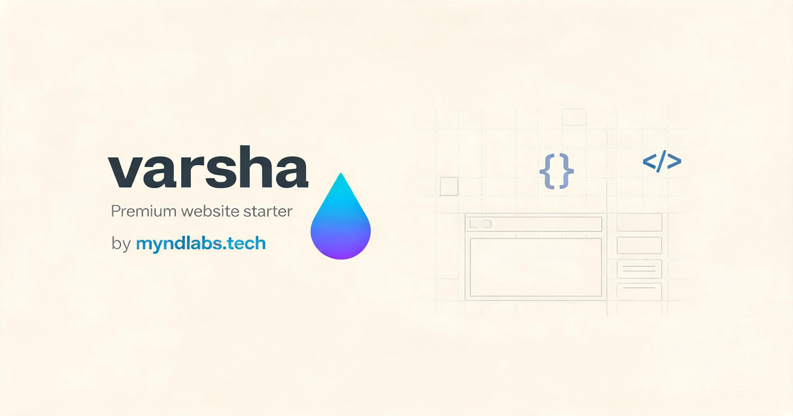

# Tema Varsha Blog — IA 2.0

> Template editorial moderno, minimalista e altamente performante para blogs de tecnologia, inteligência artificial e negócios na plataforma **IA 2.0**. Adaptado a partir do design system **Varsha** (Web UI Template) com arquitetura completa Astro 5 e CMS integrado.



---

## ✦ Destaques Visuais & Funcionalidades

- **Design Editorial Varsha**: Layout sofisticado focado em legibilidade e tipografia precisa (*JetBrains Mono* + sans-serif refinado).
- **Seletor de 18+ Paletas Dinâmicas**: Troca rápida de temas visuais pressionando a tecla `[/]` ou `[t]` (Tokyo Night, Terminal Black, Catppuccin Mocha/Latte, Nord, Gruvbox, Dracula, Solarized, Retro Paper e mais).
- **Painel CMS Completo (`/admin`)**:
  - Gerenciador de Artigos com editor Markdown/Rich-Text.
  - Gerador de Artigos com Inteligência Artificial.
  - Gestão de Categorias, Autores, Redirecionamentos e Menu.
  - Central de Plugins (Google Tag Manager, Meta Pixel, AdSense, Cookie Consent, Social Share).
  - Gestão de Afiliados e Sequências de E-mail / Leads.
- **Astro 5 Content Collections**: Tipagem estrita com TypeScript, rotas automáticas para categorias, busca dinâmica no acervo e páginas institucionais (*Sobre*, *Contato*, *Privacidade*, *Termos*).
- **SEO & Performance Máxima**: Suporte a Schema.org, Open Graph, Twitter Cards, Sitemap XML automático e pontuação 100 no Google PageSpeed.

---

## 🚀 Como Executar Localmente

```bash
# 1. Instalar dependências
npm install

# 2. Iniciar servidor de desenvolvimento
npm run dev

# 3. Gerar build de produção
npm run build
```

O site estará disponível em `http://localhost:4321` e o painel administrativo em `http://localhost:4321/admin`.

---

## 📁 Estrutura de Arquivos

```
tema-varsha-blog/
├── public/
│   ├── assets/          # Fontes JetBrains Mono, favicons, logos
│   ├── css/             # style.css e a11y-tokens.css do Varsha
│   └── preview.png      # Imagem de capa do tema
├── src/
│   ├── components/
│   │   ├── admin/       # Dashboard administrativo e editores React
│   │   └── varsha/      # Componentes do design system Varsha (BlogCard, AuthorCard)
│   ├── content/
│   │   ├── blog/        # Artigos em Markdown
│   │   └── config.ts    # Schema do Content Collection
│   ├── data/            # Configurações JSON sincronizadas com o CMS
│   │   ├── siteConfig.json
│   │   ├── home.json
│   │   ├── categories.json
│   │   ├── authors.json
│   │   └── menu.json
│   ├── layouts/
│   │   └── BaseLayout.astro # Layout mestre Varsha com header, footer e seletor de tema
│   └── pages/           # Rotas públicas e rotas do CMS /admin
```

---

## 📄 Licença

Distribuído sob licença MIT. Criado e mantido para a plataforma IA 2.0 por [ygorluz](https://github.com/ygorluz).
